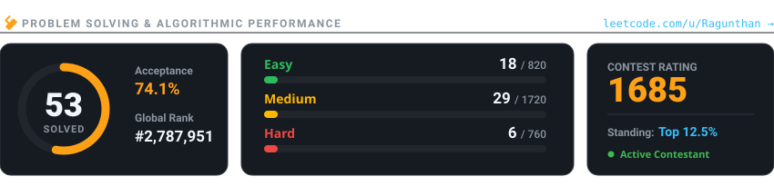

  <!-- HERO BANNER -->
  

    

  <!-- NAVIGATION & QUICK DIRECTIONS -->
  
  &nbsp;&nbsp;
  
  &nbsp;&nbsp;
  

    

  <!-- PROBLEM SOLVING & LEETCODE PERFORMANCE -->
  

    

  <!-- CORE CLOUD, NETWORKING & DEVOPS STACK -->
  

    &nbsp;
    &nbsp;
    &nbsp;
    &nbsp;
    &nbsp;
    &nbsp;
    &nbsp;
    
  

   

  <!-- LIVE PORTFOLIO CALLOUT -->
  

    Explore interactive engineering projects, architectures & case studies on my portfolio:
  

  

    

  <!-- FOOTER -->
  

    © 2026 Ragunthan P R · Cloud · Networking · DevOps
  

