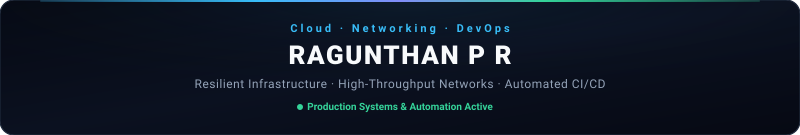
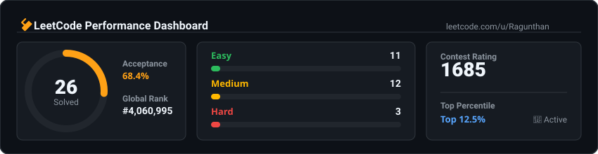

<!-- 
================================================================================
RAGUNTHAN P R — CLOUD, NETWORKING & DEVOPS ENGINEER
================================================================================
-->

  <!-- HERO BANNER -->
  

    

  <!-- DIRECT ACTION LINKS (LINKEDIN & PORTFOLIO ONLY) -->
  
  &nbsp;&nbsp;&nbsp;&nbsp;
  

 

<!-- SECTION 1: CORE TECHNICAL DOMAINS -->
### ⚡ Core Engineering Competencies

<table width="100%" border="0" cellspacing="0" cellpadding="0">
  <tr>
    <td width="33.3%" valign="top" bgcolor="#161b22" style="padding: 14px; border: 1px solid #30363d; border-radius: 8px;">
      <b>☁️ Cloud &amp; Containers</b> 
      AWS Architecture, Docker Containerization, Kubernetes Orchestration &amp; Resilient Clusters.  
      
    </td>
    <td width="33.3%" valign="top" bgcolor="#161b22" style="padding: 14px; border: 1px solid #30363d; border-radius: 8px;">
      <b>🌐 Networking &amp; Security</b> 
      VPC Subnetting, TCP/IP, DNS, NGINX Reverse Proxy, Load Balancing &amp; SecOps.  
      
    </td>
    <td width="33.3%" valign="top" bgcolor="#161b22" style="padding: 14px; border: 1px solid #30363d; border-radius: 8px;">
      <b>🚀 DevOps &amp; Automation</b> 
      CI/CD Pipelines, Infrastructure as Code, Linux Administration, Python &amp; Bash Scripting.  
      
    </td>
  </tr>
</table>

 

<!-- SECTION 2: PROBLEM SOLVING & METRICS -->
### 🧩 Problem Solving &amp; Algorithmic Discipline

  

 

<!-- SECTION 3: FEATURED INFRASTRUCTURE & SYSTEMS -->
### 🛠️ Featured Systems &amp; Deployments

<table width="100%" border="0" cellspacing="0" cellpadding="0">
  <tr>
    <td width="50%" valign="top" bgcolor="#161b22" style="padding: 16px; border: 1px solid #30363d; border-radius: 8px;">
      <h4>☁️ Automated Cloud DevOps CI/CD Pipeline</h4>
      
Multi-stage pipeline featuring automated build triggers, testing, containerization, image vulnerability scanning, and zero-downtime deployment.

      

        
        
        
        
      

      

      
    </td>
    <td width="50%" valign="top" bgcolor="#161b22" style="padding: 16px; border: 1px solid #30363d; border-radius: 8px;">
      <h4>🌐 Resilient Network Architecture &amp; Transit Hub</h4>
      
Secure multi-tier network topology implementing public/private subnets, NAT gateways, NGINX reverse proxy caching, and traffic encryption.

      

        
        
        
        
      

      

      
    </td>
  </tr>
</table>

 

<!-- FOOTER -->

  
Let's connect for Cloud, Network Architecture &amp; DevOps collaborations:

  

    <a href="https://www.linkedin.com/in/ragunthan-p-r/"><b>LinkedIn Profile</b></a>
    &nbsp;•&nbsp;
    <a href="[REPLACE_WITH_PORTFOLIO_URL]"><b>Personal Portfolio</b></a>
  

  
© 2026 Ragunthan P R · Infrastructure &amp; DevOps Engineering

